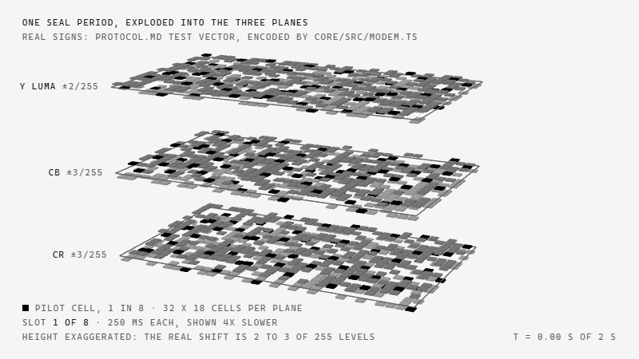
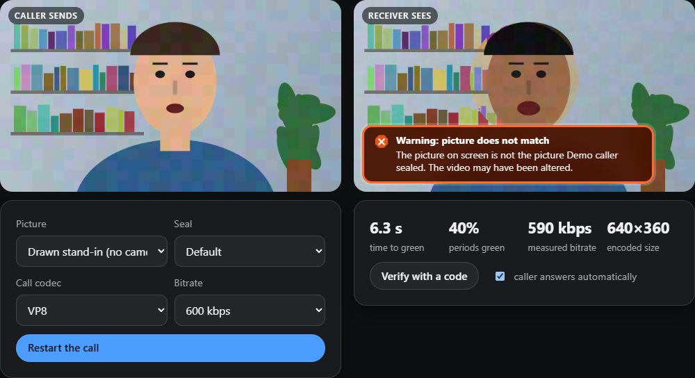

<picture>
  <source media="(max-width: 600px) and (prefers-color-scheme: dark)" srcset=".github/assets/hero-mobile-dark.svg">
  <source media="(max-width: 600px)" srcset=".github/assets/hero-mobile-light.svg">
  <source media="(prefers-color-scheme: dark)" srcset=".github/assets/hero-dark.svg">
  
</picture>

<picture>
  <source media="(max-width: 600px) and (prefers-color-scheme: dark)" srcset=".github/assets/rule-mobile-01-dark.svg">
  <source media="(max-width: 600px)" srcset=".github/assets/rule-mobile-01-light.svg">
  <source media="(prefers-color-scheme: dark)" srcset=".github/assets/rule-01-dark.svg">
  
</picture>

LiveSeal lets the other side of a video call check who is really sending the picture. Every two
seconds the caller's device signs a short statement with its own key and hides it in the video
pixels. The receiving device reads the statement back out, checks it against a key it already
trusts, and shows a green, amber or red badge.

It proves the real sender. It does not detect fakes. An unsealed call is "not verified", never
"fake", and most honest callers have no seal.

It is a research prototype. It was measured in a codec simulator and in a WebRTC call looped back
inside one browser. No call between two machines has been made with it.

<picture>
  <source media="(max-width: 600px) and (prefers-color-scheme: dark)" srcset=".github/assets/rule-mobile-02-dark.svg">
  <source media="(max-width: 600px)" srcset=".github/assets/rule-mobile-02-light.svg">
  <source media="(prefers-color-scheme: dark)" srcset=".github/assets/rule-02-dark.svg">
  
</picture>

**The problem.** A face and a voice on a video call are weak evidence once real-time face swaps
and voice clones exist. Detectors try to spot the fake, and a better fake beats them.

**What was missing.** A way for the genuine sender to prove itself through any call product,
without a server or an account. The proof has to survive the call's video codec, be bound to this
moment and this call, and be bound to the pictures that were actually sent, so a valid seal cannot
be lifted onto other footage. A signature every 2 seconds needs about 500 payload bits per second
in the picture, far more than classic invisible watermarks carry. That channel is what this
repository builds and measures.

**Who it is for.** People who want to check a known contact on a call, and organisations that want
their staff's calls to be checkable. An organisation publishes its keys at
`https://<domain>/.well-known/liveseal.json`; `demo-bank/` shows that flow.

Design rationale: [`docs/DESIGN.md`](docs/DESIGN.md). Attacks it is built against:
[`docs/THREAT_MODEL.md`](docs/THREAT_MODEL.md).

<picture>
  <source media="(max-width: 600px) and (prefers-color-scheme: dark)" srcset=".github/assets/rule-mobile-03-dark.svg">
  <source media="(max-width: 600px)" srcset=".github/assets/rule-mobile-03-light.svg">
  <source media="(prefers-color-scheme: dark)" srcset=".github/assets/rule-03-dark.svg">
  
</picture>

<picture>
  <source media="(max-width: 600px) and (prefers-color-scheme: dark)" srcset=".github/assets/flow-mobile-dark.svg">
  <source media="(max-width: 600px)" srcset=".github/assets/flow-mobile-light.svg">
  <source media="(prefers-color-scheme: dark)" srcset=".github/assets/flow-dark.svg">
  
</picture>

1. **Keys.** Each user has one Ed25519 key pair, created as a non-extractable WebCrypto key and
   kept in IndexedDB. Browsers without Ed25519 in WebCrypto get a software key, with a warning in
   the UI. Contacts are pinned by scanning a QR code and comparing a safety number.
2. **Digest.** Both ends reduce every frame to 320 x 180 luma. The sender finds the face with an
   on-device MediaPipe detector and signs the face box. The 32-byte digest holds four 48-bit
   gradient hashes of the face and two 32-bit whole-frame hashes from the previous 2 seconds.
3. **Statement.** Version, call challenge, key id, period index, face box, digest and an optional
   challenge for the peer, as deterministic CBOR, signed with Ed25519. 122 bytes on the wire, 125
   with a challenge.
4. **Channel.** The statement gets a length byte and a CRC-32, then a repeat-accumulate LDPC code
   at about rate 1/5 and an interleaver. It is sent as up or down shifts of 2 levels on luma and 3
   on each colour plane, in a 32 x 18 grid of cells, with symbols of a quarter second sent as
   differential pairs. One cell in eight is a pilot.
5. **Decode.** The receiver subtracts the two halves of each pair to cancel the still picture,
   uses the pilots for timing and per-plane amplitude, and runs a soft-decision LDPC decode. A
   frame that fails the CRC is "no readable seal", never tampering.
6. **Check.** In fixed order: pilots, decode, pinned key, signature, revocation, session,
   freshness, replay, content. The content check compares the signed digest with a digest of the
   frames actually received.
7. **Badge.** Green needs two valid statements in a row from the same key, the newest one
   content-checked, so the first green comes 4 to 6 seconds after watching starts. Amber means no
   seal, unreadable, unknown key or uncertain content. Red means a clean decode that fails a
   check, and is held for several periods.

<picture>
  <source media="(prefers-color-scheme: dark)" srcset=".github/assets/scene-dark.gif">
  
</picture>

<sub>One 2-second seal period of the protocol's own test vector (`docs/PROTOCOL.md` section 12),
encoded by `core/src/modem.ts` with its default settings: three planes, 32 x 18 cells, 8 slots of
250 ms, one pilot in 8. Cell height is exaggerated (the real shift is 2 to 3 of 255 levels) and time
is slowed four times.</sub>

<picture>
  
</picture>

<sub>A real screenshot of `lab/`, VP8 at 600 kbps inside one browser. Another face was pasted in
under a copied seal and the badge turned red. The faint block mosaic on the flat wall is the seal
itself: on clean, flat backgrounds it can be seen.</sub>

<picture>
  <source media="(max-width: 600px) and (prefers-color-scheme: dark)" srcset=".github/assets/rule-mobile-04-dark.svg">
  <source media="(max-width: 600px)" srcset=".github/assets/rule-mobile-04-light.svg">
  <source media="(prefers-color-scheme: dark)" srcset=".github/assets/rule-04-dark.svg">
  
</picture>

What the code does today. None of it has run on a real call between two machines.

- **Protocol core.** CBOR, Ed25519, LDPC and Reed-Solomon codes, modem, digest, contacts,
  revocation, verification state machine, sender and receiver sessions. Pure TypeScript, no DOM.
  `core/src`
- **Codec simulator.** Pushes sealed clips through ffmpeg's VP8, VP9, H.264 and AV1 encoders and
  feeds the result to the real receiver. Also the digest research and the attack suite. `codec-sim`
- **Browser parts.** WebGL2 sealing shader, Insertable Streams sealer, worker verifier, key storage,
  badge, pairing panel. `shared`
- **Lab.** A sealed call through a real `RTCPeerConnection` pair inside one page, with attack
  buttons. `lab`
- **LiveSeal Camera.** A PWA that seals the webcam, meant to feed a virtual camera. `sender`
- **Verifier.** Checks a screen through a phone camera or window capture; `checker.html` checks a
  recorded call and reports every 2 seconds. `verifier`
- **Extension.** Manifest V3. Seals `getUserMedia` on web call sites and badges incoming video
  tiles. `extension`
- **Demo organisation.** A pretend bank that publishes `.well-known/liveseal.json`. `demo-bank`
- **Blind visibility test.** Sealed and unsealed copies in random order, 20 rounds. `abtest`

Results from [`docs/EVALUATION.md`](docs/EVALUATION.md):

| Measure | Result | Level |
|---|---|---|
| Statements recovered, VP8 600 kbps, 640x360, default seal | 347 of 348 (99.7%) | Simulator |
| Green periods among attacks that replace person, scene, key or time | 0 of 10,608 | Simulator |
| Periods reported as sealed in 3,900 s of unsealed video | 0 | Simulator |
| Time to green, VP8 600 kbps, cold start | 5.7 to 7.4 s, median 6.5 s | Browser loop-back |
| Sealing cost at 1280x720 | 17.7% of one core at 30 fps | Browser loop-back |
| Calls between two machines | 0 | Real call |

**Known limits.** These come from the repository's own evaluation and design notes.

- **It does not stop deepfakes.** It can only prove a sealed sender. No seal means no information.
- **The sound is not covered.** A genuine sealed picture with a cloned voice over it stays green.
- **Small edits pass.** A mouth-only edit of a genuine sealed stream was green in 266 of 350
  periods, and a 3% face warp in 80 of 168. No neural face-swap model was tested.
- **Not invisible.** On a flat, clean background the default seal shows as a faint mosaic. No
  human visibility test has been run.
- **Moving cameras fail.** A hand-held clip recovered at most two thirds of its statements.
- **Low bitrates fail.** VP8 at 300 kbps, and 720p VP8 at 600 kbps, lose most statements.
- **Targets missed.** Time to green is 4 to 6 s by design against a 5 s target. Sealing at 720p
  costs 17.7% of a core against a 15% target.
- **The extension** was never loaded on a real call site, and signs a fixed central box instead
  of tracking the face.
- **A seal proves a key and a device, not a person.** A stolen unlocked device seals until its
  key is revoked.

<picture>
  <source media="(max-width: 600px) and (prefers-color-scheme: dark)" srcset=".github/assets/rule-mobile-05-dark.svg">
  <source media="(max-width: 600px)" srcset=".github/assets/rule-mobile-05-light.svg">
  <source media="(prefers-color-scheme: dark)" srcset=".github/assets/rule-05-dark.svg">
  
</picture>

Requires Node.js 22.18 or newer. Commands below were run on Windows 11 with Node 26.13 and npm
11.20, in Git Bash. They were not tested on macOS or Linux; CI runs the same steps on Ubuntu with
Node 24.

```bash
git clone https://github.com/hesselb20-ctrl/liveseal.git
cd liveseal
npm ci
```

Run the unit tests. No codec is needed. Expect `pass 49`, `fail 0`, in about 70 seconds.

```bash
npm test
```

Type-check. Expect no errors.

```bash
npm run typecheck
```

Copy the face detector into `public/vendor/`. It fetches a small model file from Google storage
on first run; without it, sealing falls back to a fixed central box. Expect
`copied MediaPipe WASM runtime`, then `fetched face model` (or `face model already present`).

```bash
node scripts/vendor.ts
```

Start the site at `http://localhost:5173/` and open **Lab** (`/lab/`). It runs a sealed call inside
your browser with a drawn stand-in or your camera, and lets you play the attacker.

```bash
npm run dev
```

Build the static site into `dist/` and the extension into `extension/dist/`. Expect
`extension built in extension/dist (5 bundles)`.

```bash
npm run build
```

Loading `extension/dist/` as an unpacked extension was not done here. Reproducing the measurements
needs ffmpeg with libvpx, libx264 and libaom and about 3.7 GB of Xiph test clips; it was not run
here. The scripts are `scripts/fetch-testdata.sh`, `scripts/run-sweeps.sh` and the `sim:*`
entries in [`package.json`](package.json); the method is in [`docs/EVALUATION.md`](docs/EVALUATION.md).

<picture>
  <source media="(max-width: 600px) and (prefers-color-scheme: dark)" srcset=".github/assets/rule-mobile-06-dark.svg">
  <source media="(max-width: 600px)" srcset=".github/assets/rule-mobile-06-light.svg">
  <source media="(prefers-color-scheme: dark)" srcset=".github/assets/rule-06-dark.svg">
  
</picture>

**Stack**

| Layer | Built with |
|---|---|
| Core, simulator, scripts | TypeScript run directly by Node 22.18+, Node's built-in test runner |
| Pages | Vite 7, static multi-page site, no server code |
| Face detection | MediaPipe Tasks Vision, WASM, on the device |
| Signatures | WebCrypto Ed25519, `@noble/ed25519` as fallback |
| Pairing | `qrcode-generator`, `jsqr` |
| Sealing | WebGL2 shader, Insertable Streams |
| Extension | Manifest V3, bundled with esbuild |
| Measurement | ffmpeg (libvpx, libx264, libaom), `playwright-core` for the browser loop-back |

**Status**

| Part | State |
|---|---|
| Protocol core | Built. 49 unit tests pass. |
| Hidden channel and digest | Measured in the simulator with real codecs on public test clips. |
| Lab, sender, verifier, checker, demo bank | Build and run locally. Lab measured in a browser loop-back on one Windows laptop. |
| Extension | Builds. Never loaded on Meet, Teams, Zoom or Jitsi. |
| Real call between two machines | Not done. |
| Human visibility test | Not done. The test page exists. |
| Browsers | Only a Chromium-based browser was used. |
| Deployment | None. The CI workflow can publish to GitHub Pages; it is off by default. |

**Roadmap.** The open items listed in `docs/EVALUATION.md` section 8, in the order the previous
README ranked them:

1. Real calls: two devices, real cameras, real networks, Jitsi first, then Meet, Teams and Zoom.
2. Close the small-edit gap and bind the sound: a tighter binding of the mouth region and an audio
   fingerprint in the signed statement.
3. Visibility and moving cameras: a carrier that viewers cannot see, a blind test with people, and
   motion compensation in the receiver.

Also open: phone mode on real hardware, the virtual-camera bridge through OBS, a neural face-swap
attack, face tracking in the extension, WebGPU, Firefox and Safari.

**Documents**

| File | Contents |
|---|---|
| [`docs/DESIGN.md`](docs/DESIGN.md) | Components, keys, digest, channel, badge rules, limits of the design |
| [`docs/PROTOCOL.md`](docs/PROTOCOL.md) | Wire format, error correction, digest, checks, test vector |
| [`docs/THREAT_MODEL.md`](docs/THREAT_MODEL.md) | Attacker model and how each attack is handled |
| [`docs/EVALUATION.md`](docs/EVALUATION.md) | Every measurement, including the failures, and what was not done |
| [`docs/media/liveseal-tutorial.mp4`](docs/media/liveseal-tutorial.mp4?raw=true) | 99-second explainer video, no sound, 5.8 MB download. Its drawings show the seal far stronger than it is. |

<picture>
  <source media="(max-width: 600px) and (prefers-color-scheme: dark)" srcset=".github/assets/rule-mobile-07-dark.svg">
  <source media="(max-width: 600px)" srcset=".github/assets/rule-mobile-07-light.svg">
  <source media="(prefers-color-scheme: dark)" srcset=".github/assets/rule-07-dark.svg">
  
</picture>

MIT. See [`LICENSE`](LICENSE).

Runtime dependencies keep their own licences: MediaPipe Tasks Vision and `jsqr` (Apache 2.0),
`@noble/ed25519` and `qrcode-generator` (MIT). Test clips used for the measurements come from the
Xiph.org collection and are not included in this repository.
