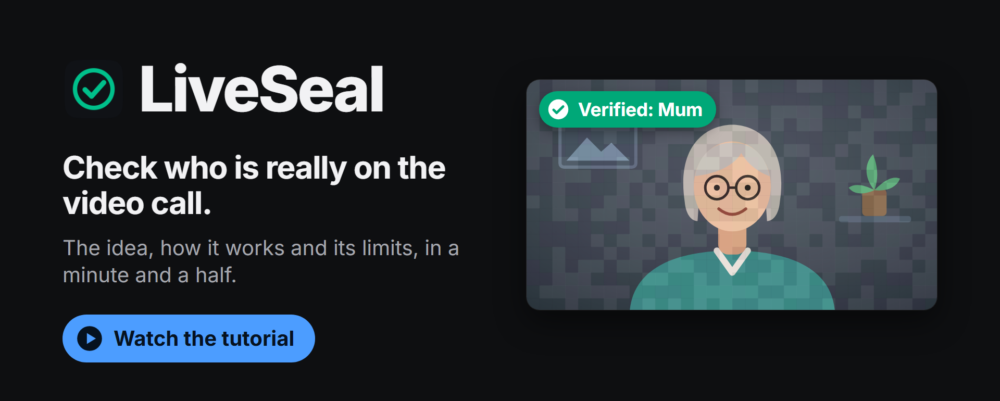
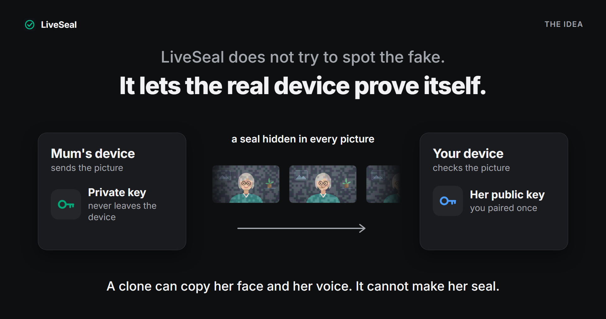
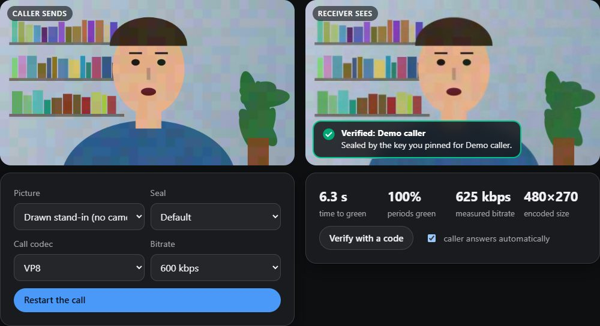

# LiveSeal

**Check who is really on the video call.**

[](docs/media/liveseal-tutorial.mp4)

*[Watch the tutorial](docs/media/liveseal-tutorial.mp4): a minute and a half,
no sound.*

A face and a voice on a video call are no longer proof of anything: real-time
face swaps and voice clones are good enough to pass as your bank, your boss or
your mother. LiveSeal takes the opposite approach to "deepfake detectors". It
does not try to spot the fake. It lets the real person's device prove itself.



The caller's device hides a small cryptographic seal inside its video
picture. Your device reads the seal back out of the picture and checks it:

* **Green, "Verified: Mum"**: the picture carries a fresh seal from the key
  you paired with her, and it is the picture her device sealed.
* **Amber, "Not verified"**: there is no seal, or it cannot be read. On its
  own this tells you nothing. If Mum normally seals her calls, LiveSeal says
  so in plain words.
* **Red, "Warning"**: there is a seal and it fails a check. Wrong signature,
  an old recording, a seal made for another call, or a picture that is not the
  one that was sealed.


Everything runs on your own device. No accounts, no servers, no tracking, and
no video ever leaves the page that processes it.

## Status: research preview

Please read this before relying on LiveSeal for anything.

| | |
|---|---|
| **Works in tests** | The whole chain, measured in a simulator that pushes sealed video through real VP8, VP9, H.264 and AV1 encoders, and in a real WebRTC call looped back inside one browser. |
| **Not tested** | A real call between two devices. No Jitsi, Meet, Teams, Zoom or WhatsApp call has been made with it. The browser extension has never been loaded on a real call site. |
| **Not invisible** | On a flat, clean background the seal can be seen as a faint mosaic of coloured blocks. A real camera picture hides it better; how much has not been measured. A blind test page exists; nobody has taken it yet. |
| **Known to fail** | Callers holding a phone in their hand (a moving camera breaks the seal), VP8 below about 600 kbps, 720p video below about 1 Mbps. |
| **Known gap** | Changing only the mouth of a genuine sealed stream was not caught in testing. |

All measurements, including the unflattering ones, are in
[docs/EVALUATION.md](docs/EVALUATION.md).

## What LiveSeal can and cannot prove


It **can** show that:

* the picture was sealed by a device holding a key you paired with, or a key
  that an organisation publishes on its own web address;
* the seal was made in the last few seconds, and for this particular call if
  you ask the caller for a three-word code;
* the person in the picture has not been swapped for someone else after the
  picture was sealed.

It **cannot** show:

* **that an unsealed call is fake.** No seal means "unknown". Most honest
  callers will have no seal.
* **anything about the sound.** The seal covers the picture only. A real
  sealed picture with a cloned voice over it stays green.
* **small edits.** The seal tolerates what video compression does to a
  picture, so an edit that is no bigger than that can slip through. In testing,
  replacing only the mouth region was mostly not caught.
* **who is holding the device.** A stolen, unlocked device seals just as well
  until its owner revokes the key.
* **anything if the caller's own device is compromised**, or if a real person
  chooses to lie to you.

LiveSeal is one more check, not a replacement for hanging up and calling back
on a number you already know.

## Try it

Build the site (two commands, see "For developers" below), open it, and go
to **Lab**. It runs a sealed call inside your browser, with a drawn stand-in
or your own camera, and lets you play the attacker: remove the seal, swap the
face, replay a recording, use someone else's key.

| A genuine sealed call in the lab | Another face under a copied seal |
|---|---|
|  |  |

These two are real screenshots. Look closely at the flat wall and you can see
the seal as a faint mosaic of blocks; that is the "not invisible" row in the
status table above.

| Page | What it is for |
|---|---|
| `lab/` | A sealed call in one page, with attack buttons. |
| `sender/` | **LiveSeal Camera.** Seals your webcam. With the free OBS virtual camera it feeds Zoom, Teams or WhatsApp Desktop. |
| `verifier/` | **Verify a screen.** Point a phone at any screen showing a call, or capture the call window. |
| `verifier/checker.html` | **Check a recording.** Drop in a recorded call, get a report for every two seconds. |
| `demo-bank/` | A pretend bank that publishes its keys, to show how an organisation proves its calls. |
| `abtest/` | "Can you see the seal?" A blind test you can take. |
| `extension/` | Browser extension (Chrome, Edge, Firefox): seals your camera on web call sites and puts a badge on each person's picture. |


### Pairing

To verify someone you first need their key. On the camera page or in the
extension each person has a pairing code (a QR code). Scan each other's code,
then read out the **safety number** that both screens show, in person or over
a channel you already trust. If the numbers are the same, you have each
other's real keys.

### If a device is lost

Print the **recovery sheet** when you set LiveSeal up. It holds a code that
revokes your key. Send that code to your contacts; once they add it, calls
sealed with the lost key show a warning. Then create a new key and pair again.
Until a contact has added the code, a thief with your unlocked device can
still produce valid seals.

## How it works, in three steps


In these drawings and in the tutorial the seal is drawn far stronger than it
is. The real change is 2 to 3 steps out of 255 per block.

1. **The caller's device signs.** Every two seconds it signs a short
   statement with an Ed25519 key: this key, now, for this call, and a
   fingerprint of the pictures it just sent.
2. **The statement rides in the picture.** Large blocks of the picture are
   made very slightly brighter or darker, and slightly shifted in colour, in a
   pattern that changes four times a second. Video compression keeps changes
   like that, so the statement survives the call. It does not depend on the
   call app.
3. **Your device checks.** It reads the pattern, corrects errors, checks the
   signature against a key you already trust, and compares the pictures it
   received with the fingerprint that was signed.

A clone has no key, so it cannot sign. A recording is too old. And a genuine
seal copied onto other pictures no longer matches them.


Smaller edits are a known gap: see the status table at the top.

The design is explained in [docs/DESIGN.md](docs/DESIGN.md), the attacks it
is built against in [docs/THREAT_MODEL.md](docs/THREAT_MODEL.md), and the
exact formats in [docs/PROTOCOL.md](docs/PROTOCOL.md).

## Privacy

* Verification happens on your device. No video, frame or face is sent
  anywhere by LiveSeal.
* There is no telemetry.
* The seal contains a short key identifier, the time, the three-byte call
  code, the position of the face in the picture and the picture fingerprint.
  Anyone who can see your video can read these. The key identifier is the
  same in every call you seal, so two sealed calls can be linked to the same
  sender. The seal contains no name and no account.

## For developers

Requirements: Node.js 22.18 or newer. For the simulator also a free
[ffmpeg](https://ffmpeg.org/) build with libvpx, libx264 and libaom on the
PATH.

```
npm install
npm test                      # unit tests (no codec needed)
node scripts/vendor.ts        # copy the face detector's files into public/vendor
npm run dev                   # the site at http://localhost:5173
npm run build                 # static site in dist/, extension in extension/dist/
```

Load `extension/dist/` as an unpacked extension (Chrome, Edge) or as a
temporary add-on (Firefox).

The site is a folder of static files (`dist/`) and can be served from any
static host. The included workflow can publish it to GitHub Pages; that is
switched off by default (see the note in `.github/workflows/ci.yml`).

Reproducing the measurements:

```
bash scripts/fetch-testdata.sh all          # public Xiph test clips, about 3.7 GB, into data/
bash scripts/run-sweeps.sh 4                # channel suites
node codec-sim/digest-extract.ts            # digest research, stage 1
node codec-sim/digest-eval.ts               # stage 2: compare the candidates
node codec-sim/run-attacks.ts               # attack suite
node codec-sim/make-tables.ts               # rebuild the tables in docs/EVALUATION.md
```

Test footage, attack videos and result files live in `data/`, which is
git-ignored and never published.

| Folder | Contents |
|---|---|
| `core/` | Protocol, crypto, error correction, modem, digest, state machine. Pure TypeScript, no DOM. |
| `codec-sim/` | Real-codec simulator, digest research, attack suite. |
| `shared/` | Browser code used by several apps. |
| `sender/`, `verifier/`, `lab/`, `abtest/`, `demo-bank/` | The pages. |
| `extension/` | Manifest V3 extension. |
| `docs/` | Design, threat model, protocol, evaluation. |

Dependencies are MIT, BSD or Apache licensed: MediaPipe Tasks (face
detection), noble-ed25519 (fallback signatures), jsQR and qrcode-generator.
Development tools (Vite, TypeScript, esbuild, playwright-core) are MIT or
Apache licensed as well.

## Roadmap

The three most important next steps, in order:

1. **Real calls.** Two devices, real cameras, real networks, on Jitsi first,
   then Meet, Teams and Zoom. Everything in this repository is a prediction
   until that is done.
2. **Close the small-edit gap and bind the sound.** A tighter binding of the
   mouth region (landmark motion or a finer hash) and a fingerprint of the
   audio in the signed statement, so that lip-sync edits and dubbed voices
   are caught.
3. **Visibility and moving cameras.** The seal that survives the VP8
   denoiser is visible on flat backgrounds; finding a carrier that is not
   (and a blind test with people to prove it) is open. So is motion
   compensation in the receiver, without which hand-held callers cannot be
   verified.

Also open: phone mode on real hardware, the virtual-camera bridge, a neural
face-swap attack on footage we are allowed to use, and voice-only calls.

## Licence

MIT. See [LICENSE](LICENSE).
